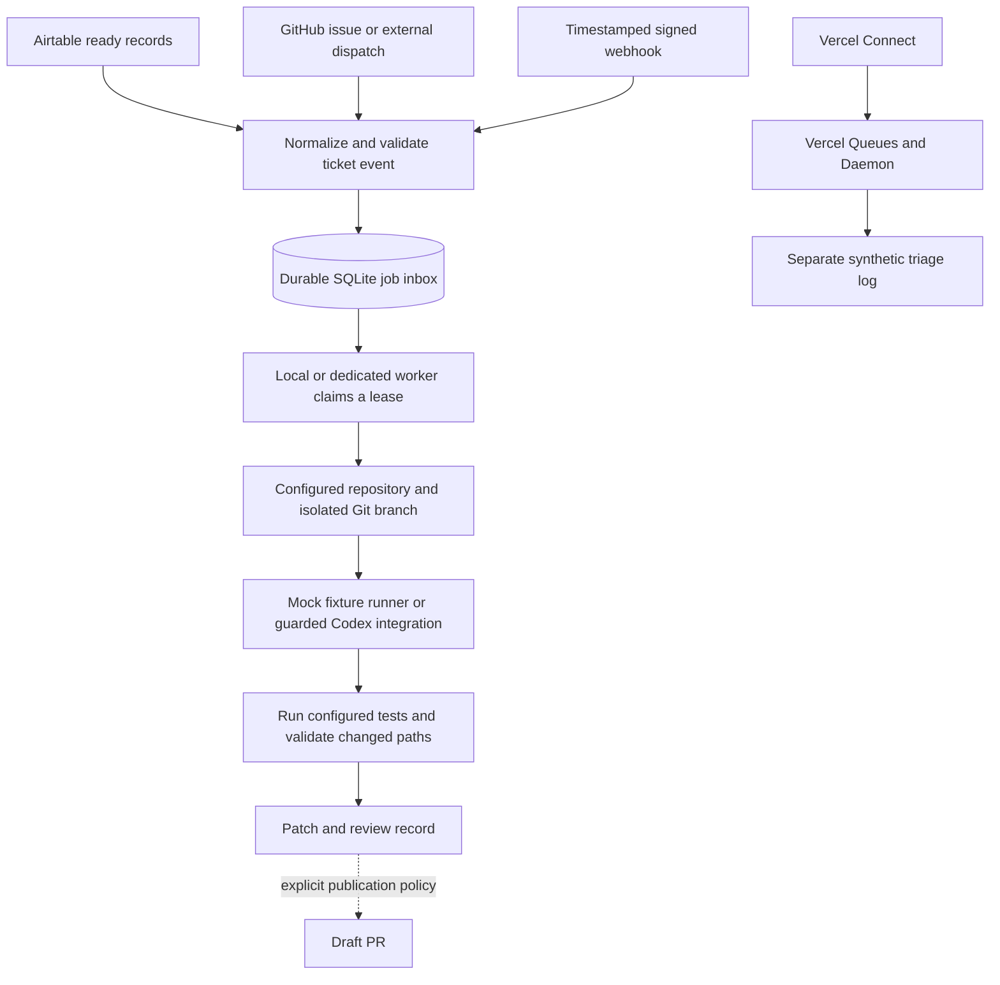

# Event Driven AI Agents

Start useful agent work when a ticket becomes ready. Choose a local watcher, a signed webhook, GitHub Actions, a dedicated server, or the Vercel reference implementation.

**Prototype with working synthetic demos.** The portable demo makes a real isolated Git branch, fixes a deliberately broken calculator, runs its tests, and saves a patch and review record. Its default worker is deterministic and costs **$0 in model calls**. Live Codex and remote PR publication are separate, guarded integration paths; there is no automatic merge or deployment.

## Which setup should I choose?

| Setup | Main use case | Why choose it? | Tradeoff / current scope |
|---|---|---|---|
| **Local Airtable watcher** | A personal or small-team ticket inbox with a local checkout | Simple, no public listener; check for ready tickets and start work locally | Machine must be awake. Read-only Airtable integration; fixture replay is the default |
| **Signed webhook bridge** | React promptly to events from multiple products | Any sender can use one documented event contract; workers can run elsewhere | An internet-facing receiver needs HTTPS, durable storage and credentials. No built-in provider-specific webhook impersonation |
| **GitHub Actions** | Repository-centered work, maintainer-labeled issues and external dispatches | Temporary hosted compute; no laptop dependency | Hosted filesystem is temporary. Cross-run deduplication needs a durable external queue; checked-in live-event workflow is an inactive example |
| **Dedicated server / Docker Compose** | An always-on worker on a machine or Linux VM you manage | Own the runtime and retain jobs across process/container restarts | Operate and back up the service. SQLite supports this single-host setup, not a distributed cluster or shared network filesystem |
| **Vercel Connect + Queues + Daemon** | Managed MCP event subscriptions and background triage | Vercel manages upstream subscriptions and queue infrastructure | Separate self-contained triage reference. Production-only Daemon beta restrictions and infrastructure costs apply; this example does not execute the portable Codex coding worker |

Trigger choice and execution location are independent. The webhook receiver can stay online while a laptop worker is offline; a queued job waits until the worker returns. A dedicated worker can also process the local Airtable feed. The portable workflow does not require MCP.

## Architecture



Job IDs deduplicate repeated delivery. Reusing an event ID with changed content is rejected: use an explicit new ticket revision. Workers have fenced leases, retry delay and a three-attempt ceiling. A stale worker cannot acknowledge another worker's lease. A process crash leaves reclaimable work; failed jobs remain visible in the database. This is at-least-once execution, with deterministic branches and result records for recovery—not a general exactly-once guarantee for external side effects.

## Quick start: no accounts, secrets or model calls

Use **Node 24**, npm and Git:

```sh
npm ci --ignore-scripts
npm run check
npm run demo
```

Dependency installation needs network access. Tests and demos use synthetic fixtures, local HTTP and temporary Git repositories. The demo exercises Airtable fixture ingestion, GitHub fixture ingestion and an actual signed HTTP handoff to a remote-style worker. Three jobs produce three passing code patches; the original fixture checkout stays unchanged. Artifacts are saved under ignored `.state/demo-*/` folders.

Run the trigger paths individually:

```sh
npm run airtable:poll
npm run worker -- --once
npm run github:enqueue
npm run worker -- --once
```

These commands share `.state/jobs.sqlite`. Replaying an existing fixture is a duplicate, so an already completed ticket will not run again. No arguments means fixture/mock mode. The worker creates its own synthetic repository if no operator configuration is supplied.

## Setups

### Local watcher

[Trigger setup](docs/triggers.md) documents Airtable field mapping, pagination and the explicit live opt-in. Use a dedicated **Ready** checkbox and **Run revision** field, with the checkbox set after entering the ticket. Empty records do not launch the worker. Polling uses ordinary code; an empty poll does not invoke a model.

Copy `.env.example` to an ignored `.env.local`, fill in only the variables required for your chosen integration, and use `node --env-file=.env.local scripts/poll-airtable.mjs --live`. Live access requires `ALLOW_LIVE_TRIGGERS=true` and read access to the selected base/table. The default poll interval is 60 seconds, with a minimum of 30. The agent worker runs separately. No Airtable updates, comments or PR-link writebacks are implemented.

### Webhook receiver and local worker

Generate two different random credentials of at least 32 bytes and save them as `EVENT_WEBHOOK_SECRET` and `WORKER_TOKEN` in the ignored environment file. Then, in separate terminals:

```sh
node --env-file=.env.local scripts/server.mjs
node --env-file=.env.local scripts/worker.mjs --bridge http://127.0.0.1:8787
node --env-file=.env.local scripts/send-event.mjs --send
```

The sender defaults to a dry-run unless `--send` is present. The receiver verifies a timestamped HMAC over the raw body before accepting an event, rejecting missing/invalid/stale signatures. Producer credentials cannot claim jobs. The worker makes outbound requests; it has no listener. [Protocol and hosting instructions](docs/hosting.md) explain signatures, credential boundaries, HTTPS and persistence.

### GitHub Actions

The active workflows run only secret-free tests and synthetic demos. The [maintainer-event example](examples/github-actions/agent.yml) supports a `ready-for-agent` issue label or `repository_dispatch` and checks the actor's repository authority. It is outside `.github/workflows` so copying this repository does not enable autonomous work for incoming public issues. Ticket text is read from a delivery file, never interpolated into shell code.

The example's default worker remains mock; persistent deduplication across hosted workflow runs and a real-model budget integration require additional configuration. [GitHub setup and limits](docs/triggers.md#github-actions) describe those boundaries. The manual **Synthetic ticket to review artifact** workflow can demonstrate the portable path on a GitHub-hosted runner without secrets.

### Dedicated server

The Docker image runs as an unprivileged user. Compose runs separate receiver and worker containers sharing a persistent local volume, with host access bound to loopback by default:

```sh
docker compose --env-file .env.local up --build -d
```

Send the synthetic event with the webhook command above. For a public endpoint, put an HTTPS reverse proxy in front of the receiver; the stock Compose file does not expose a public service or configure a domain. Back up the state volume and keep credentials outside the image. The mock worker needs no Codex installation or model credentials.

Reproduce the packaged integration test, which creates and removes its own temporary containers and volume:

```sh
npm run test:container
```

### Vercel reference

```sh
npm ci --prefix examples/vercel --ignore-scripts
npm run test:vercel
npm run demo:vercel
```

This separate example includes the real Connect verifier, MCP Events subscription adapter, Postgres inbox/outbox, Queues publisher, Dockerfile and Daemon config with **zero instances**. It demonstrates synthetic triage, with no LLM calls. **Live use is blocked pending review of an unresolved upstream dependency advisory**, described in [the audit findings](docs/vercel.md). Its offline tests and image build do not resolve that advisory. See [the example README](examples/vercel/README.md) and [Vercel use case and beta limits](docs/vercel.md) before considering a live trial. No Vercel deployment or real subscription is created by repository setup or CI.

## Coding agent and draft PRs

The [coding runner](docs/coding-agent.md) maps a ticket's repository key to a trusted local configuration. Ticket content cannot supply a filesystem path, command, credential or arbitrary remote repository. The runner isolates changes in a Git worktree, applies configured changed-path restrictions, runs configured checks with a reduced environment and saves a patch/result record. Worktrees separate changes; they are not an OS security boundary for arbitrary repository code.

The provided mock supports only the documented synthetic calculator fixture. It does not solve arbitrary real tickets. The optional Codex CLI path receives ticket data on stdin and records a thread ID, but **the stock CLI cannot enable paid Codex work merely by setting a flag**. It requires `ALLOW_CODEX=true` plus an installed programmatic budget enforcer guaranteeing a cumulative **$1 maximum per job, including retries**. No such spend-enforcing service is bundled, so that live-model path remains blocked by default. A time limit is not a monetary cap.

Remote publication independently requires trusted repository configuration, `publish:true`, `ALLOW_GIT_WRITES=true`, passing checks and an exact origin match. The publisher only creates a draft PR and can recover an uncertain create using its deterministic branch. Tests simulate GitHub operations; demos do not push branches or open real PRs. There is no automatic merge, deployment, arbitrary desktop-chat webhook, or assumed Codex-sidebar integration. [Official Codex automation documentation](https://learn.chatgpt.com/docs/non-interactive-mode) describes the underlying CLI interface.

## Test status and scope

[RESULTS.md](RESULTS.md) records commands actually run and distinguishes deterministic replay, process/container tests, hosted CI and unverified live integrations. Offline contract tests do not prove Airtable permissions, production webhook delivery, Vercel control-plane behavior or model solution quality. Real Codex billing enforcement and provider-specific result writebacks are explicit extension work.

Only synthetic/public example data belongs in this repository. Runtime databases, patches, local repository configuration, credentials and auth state are ignored and must stay private. See [SECURITY.md](SECURITY.md), [source references](docs/references.md) and the MIT [license](LICENSE).
