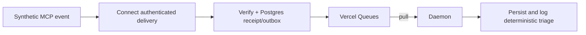

# Vercel reference transport

[`examples/vercel`](../examples/vercel/README.md) is a self-contained example of Vercel Connect MCP Events, PostgreSQL transactional acceptance, Vercel Queues, and a Daemon that pulls jobs and logs deterministic triage summaries. It demonstrates a hosted event pipeline alongside this repository's separate local watcher approach.

It does not launch Codex, create desktop chats, or produce pull requests. The local ticket-to-draft-PR runner remains the place to explore those behaviors. A future adapter between these paths would need a deliberately designed job contract, authorization, idempotency, and operator controls; none is implied by an MCP event alone.



From the repository root, with Node.js 24+:

```sh
npm --prefix examples/vercel ci --ignore-scripts --no-audit --no-fund
npm --prefix examples/vercel test
npm --prefix examples/vercel run mock
npm --prefix examples/vercel run subscriptions -- discover
```

The tests/replay need no Vercel account, database service, provider credentials, or model access once dependencies are installed. They exercise the real SDK verifier using an ephemeral offline test key, in-memory queue delivery, and the production SQL through local PGlite. The checked-in cloud configuration has zero daemon instances. Subscription commands default to dry-run; the live receiver and worker fail closed without explicit configuration. See [results](../examples/vercel/RESULTS.md) for what was actually verified.

The actual Dockerfile was also built locally for `linux/amd64`. Starting that image with networking disabled and no credentials exited with `Live mode is disabled`, as expected. This establishes local image packaging and default startup behavior; it does not verify Vercel deployment or live event processing.

**Live trial is currently blocked by an unresolved dependency advisory.** The runtime dependency chain contains Zod 4.1.11 through `@vercel/cli-config`, including an embedded copy that a normal npm override would not repair. The image audit reports four high findings stemming from [GHSA-mrhx-c7xc-m3w5](https://github.com/advisories/GHSA-mrhx-c7xc-m3w5). See the [investigation and affected versions](../examples/vercel/RESULTS.md#dependency-advisory-unresolved). Keep instances at zero until the dependency chain is resolved and reviewed.

For a future live trial, follow the [example procedure](../examples/vercel/README.md#configuration-and-live-trial-procedure). Use only a dedicated synthetic test project and connector. Daemons currently run only in Production, have manually configured per-region instance counts, and accept no inbound traffic. The beta's subfolder Root Directory restriction means this nested directory must first be staged as a standalone project root. This repository does not deploy it automatically.

Authoritative integration contracts:

- [Connect MCP Events](https://vercel.com/docs/connect/mcp-events) and [SDK reference](https://vercel.com/docs/connect/ts-sdk-reference#mcp-events): subscription adapter, authenticated delivery verifier, authorized bindings, lifecycle controls, and provider-dependent recovery limits.
- [Queues poll mode](https://vercel.com/docs/queues/poll-mode): `PollingQueueClient`, explicit region, callback acknowledgment, and retry behavior.
- [Daemon configuration](https://vercel.com/docs/daemons/config-reference) and [limits](https://vercel.com/docs/daemons/limits): Docker packaging, `instances`, production scope, no inbound HTTP, ephemeral storage, and project restrictions.
- [Vercel Node.js Functions](https://vercel.com/docs/functions/runtimes/node-js): the `/api` Web-standard `fetch` entry point.

Cloud integration behavior and infrastructure spend remain unverified. Triage makes no LLM calls; its model budget is $0. The example README records pricing dependencies and open questions instead of inventing provider schemas or cloud APIs.
