# Vercel MCP Events → queue → pull worker

This standalone reference verifies Connect deliveries, durably stores a receipt and dispatch intent in PostgreSQL, publishes the receipt ID to Vercel Queues, and runs deterministic issue triage in a Vercel Daemon. It demonstrates the event transport and recovery boundary. It does **not** execute the repository's local Codex ticket-to-draft-PR workflow.

The default commands use synthetic fixtures or print a dry run. The checked-in daemon has **zero instances**, deployed handlers fail closed without explicit live configuration, and no model calls are implemented. No account is needed after installing dependencies.

## Architecture

```mermaid
flowchart LR
  MCP[Compatible test MCP server] --> Connect[Vercel Connect MCP Events]
  Connect --> Verify[Function /api/hooks: SDK signature and identity verification]
  Verify --> TX[Postgres transaction: receipt + lifecycle + outbox]
  TX --> Publish[Publish receipt ID]
  Publish --> Queue[Vercel Queues]
  Queue -->|worker initiates receive| Daemon[Daemon pull loop]
  Daemon -->|retry pending outbox| Publish
  Daemon --> Stored[Load verified receipt and authorized binding]
  Stored --> Result[Persist one deterministic summary]
  Result --> Log[JSON stdout]
```



`experimental_verifyMcpEvent` from `@vercel/connect/mcp` verifies the Connect-to-application hop. It consumes the request body, verifies its identity and envelope, and rejects unsigned or invalid deliveries. Provider payload validation and saved subscription bindings are separate application checks. See [MCP Events](https://vercel.com/docs/connect/mcp-events) and the [SDK reference](https://vercel.com/docs/connect/ts-sdk-reference#mcp-events).

The receiver returns `204` only after durable acceptance and queue publication. Signature failures return `401`; invalid synthetic data returns `422`; unavailable verification, missing bindings, storage failures, or queue failures return retryable `503`. The receipt, lifecycle update, and outbox entry commit in one SQL transaction. If publication fails afterward, the daemon republishes pending outbox entries. Queue jobs contain only the receipt ID: the verified database envelope is authoritative.

Delivery is at least once. The database deduplicates receipts and results by delivery ID. `gap` pauses business-event processing pending source reconciliation; `terminated` and locally stopped bindings suppress new work. Summaries commit before acknowledgment. A crash between that commit and stdout can lose a log, while the stored summary remains available. No issue comments or other provider writes occur.

## Setup and offline verification

Use Node.js 24 or later and npm. From this directory:

```sh
npm ci --ignore-scripts --no-audit --no-fund
npm test
npm run mock
npm run subscriptions -- discover
npm run subscriptions -- create
npm run subscriptions -- inspect
npm run subscriptions -- list
npm run subscriptions -- stop
npm run db:migrate
```

Only dependency installation needs a network connection. Tests and replay disable outbound network in the signature harness. Replay generates an ephemeral RSA key and intercepts the SDK's Vercel JWKS request with that synthetic public key. It executes the **real pinned SDK verifier**, receiver, in-memory store/queue, and worker in one process with Web `Request`/`Response` objects. The signer lives only in test support; the deployed endpoint cannot select test keys.

`npm test` also executes the same PostgreSQL SQL through in-process PGlite, including rollback when outbox insertion fails. This is evidence for SQL behavior, not for a hosted database, network, Vercel delivery, container scheduling, or production keys. See [RESULTS.md](RESULTS.md).

The synthetic `synthetic.issue.created` payload is application-owned:

```json
{"id":"TEST-001","title":"Example export fails","body":"Synthetic reproduction only."}
```

It is **not** a claim that any provider implements that event name or schema. `discover` follows the authenticated server's catalog pages. Live creation is allowed only if that catalog offers the implemented synthetic webhook event. Supporting a real provider requires reviewing its discovered `inputSchema` and `payloadSchema` and adapting the validator first.

## Configuration and live trial procedure

Copy `.env.example` to an untracked `.env.local` and supply only synthetic or public test data. All secrets remain server-side in environment variables. Never commit a filled environment file, tokens, connector credentials, or database contents. Deployment variables may be passed as Docker build arguments by Vercel; the Dockerfile does not consume secrets as build arguments or copy environment files.

The live receiver and worker require `POC_LIVE_ENABLED=true`, `POC_TEST_DATA_ONLY=true`, and a dedicated disposable `DATABASE_URL`. Queue region is intentionally restricted to `iad1`. `LLM_ENABLED` must remain false. The receiver identity comes from trusted project/organization environment variables with the environment fixed to Production. Each daemon receives a rotating OIDC token file; the pinned `@vercel/oidc` version supports reading it. See [OIDC](https://vercel.com/docs/oidc/reference) and [Daemon environment variables](https://vercel.com/docs/daemons#environment-variables-and-oidc).

For an intentionally authorized live trial:

1. Stage this directory's tracked files as the **root of a dedicated test project**. Do not configure `examples/vercel` as a Vercel project's Root Directory: the beta currently excludes projects whose Root Directory is a repository subfolder. No repository-root Vercel configuration is provided here. The explicit `public` output directory differs from the daemon's build-context root.
2. Create a compatible synthetic MCP test connector, authorize its app or test-user subject, link the Vercel project, and permit its destination environment. Follow the [Connect quickstart](https://vercel.com/docs/connect/quickstart), [authentication](https://vercel.com/docs/connect/concepts/authentication), and [project links](https://vercel.com/docs/connect/concepts/project-links). Connect permits Production or stable Custom Environments; this combined example requires Production because Daemons do.
3. Apply `schema.sql` only to the dedicated test database. Runtime handlers never migrate automatically. The explicit mutation command is:

   ```sh
   POC_TEST_DATA_ONLY=true POC_ALLOW_DB_WRITES=true node --env-file=.env.local scripts/migrate.mjs --apply
   ```

4. Configure the test project variables and deploy the receiver intentionally, leaving daemon instances at zero initially. This repository provides no deployment command or deployment automation. Confirm `/api/hooks` reaches the Function, the Production identity is available, and failed/unsigned requests are rejected before proceeding. A Development token from `vercel env pull` does not establish Production subscription access.
5. Configure `CONNECT_CONNECTOR`, `MCP_SERVER_URL`, and the authorized `CONNECT_TOKEN_PARAMS_JSON`. Discovery is a real read operation only when explicitly selected:

   ```sh
   POC_TEST_DATA_ONLY=true node --env-file=.env.local scripts/subscriptions.mjs discover --live
   ```

6. Confirm the catalog and schema match the synthetic receiver. Persist one `MCP_IDEMPOTENCY_KEY` for the creation intent and reuse it on uncertain retries. Creating a real subscription requires both write controls:

   ```sh
   POC_TEST_DATA_ONLY=true POC_ALLOW_SUBSCRIPTION_WRITES=true node --env-file=.env.local scripts/subscriptions.mjs create --live --apply
   ```

   The CLI uses the MCP Events adapter and saves the returned subscription's authorized connector/event binding. Deliveries that race binding persistence receive `503`. Record the returned Connect ID in `MCP_SUBSCRIPTION_ID`; it is not a provider subscription ID. The monitoring TTL is ten minutes.
7. Intentionally set `instances.iad1` to one for the trial and activate that configuration. The worker pulls, processes the synthetic event, and writes JSON stdout. `SIGTERM`/`SIGINT` stop new polls; the configured shutdown grace is 50 seconds. It never listens for inbound HTTP.
8. Inspect and then stop the test subscription:

   ```sh
   POC_TEST_DATA_ONLY=true node --env-file=.env.local scripts/subscriptions.mjs inspect --live
   POC_TEST_DATA_ONLY=true POC_ALLOW_SUBSCRIPTION_WRITES=true node --env-file=.env.local scripts/subscriptions.mjs stop --live --apply
   ```

   If remote cleanup is pending, retry stop with the same ID. Return instances to zero, clear any scaling override, disable live mode, and remove disposable test data when finished. Closing the MCP client alone does not stop a subscription.

For local container inspection, `docker build -t event-triage .` builds only runtime source. `docker run --rm event-triage` fails closed with live mode disabled. The Linux amd64 image was built and its default fail-closed startup was verified locally. Intentionally configured live container execution remains unverified and requires the same dedicated test environment; it is not an offline replay. An unresolved upstream dependency advisory currently blocks the live trial; see [RESULTS.md](RESULTS.md#dependency-advisory-unresolved).

## Limits and cost

- [Daemons beta limits](https://vercel.com/docs/daemons/limits): Production only, fixed instance counts per region, no autoscaling, inbound HTTP/TCP, persistent local storage, or `vercel dev` support. The beta also excludes projects with a subfolder Root Directory. Images target Linux `amd64`. Counts of zero stop instances; [configuration uses `instances`](https://vercel.com/docs/daemons/config-reference).
- [Connect delivery limits](https://vercel.com/docs/connect/mcp-events#lifetime-and-delivery-limits): forwarding is inline. Connect provides no durable payload outbox, scheduled redelivery, delivery history, or manual replay. Recovery before receipt acceptance depends on the upstream provider's retry/replay window.
- [Queues poll mode](https://vercel.com/docs/queues/poll-mode): the callback acknowledges on successful completion and retries on throw. This example uses `PollingQueueClient`, an explicit region, a 60-second visibility timeout, one-hour retention, and a stable consumer group. `deploymentId: null` intentionally permits jobs to survive production rollouts; the database binding still scopes processing. Outages beyond retention require operator-led replay from unprocessed database receipts; the example does not automatically republish already-marked queue jobs after expiry.
- [Connect](https://vercel.com/docs/connect/pricing) bills forwarded deliveries as triggers and token requests separately. [Queues](https://vercel.com/docs/queues/pricing) bills operations, including empty receives, in 4 KiB units; idempotent sends cost twice ordinary send units. The five-second worker poll interval has infrastructure cost. [Daemons](https://vercel.com/docs/daemons/limits#pricing) bills Active CPU and Provisioned Memory on Pro/Enterprise, with Hobby quota limits.
- **Pricing unknowns:** no live bill or all-in estimate has been measured. Check current account/region rates, allowances, Function, database, container build/registry, Queue, Connect, and daemon costs before activation. Model spend is exactly **$0**: no model SDK, key, or request exists. Enabling an LLM fails closed; a future lane needs a shared durable reservation ledger and provider budget enforcing cumulative spend of at most **$1**, including retries.

## Open questions

1. Which compatible synthetic MCP test server offers the discovered schema, and what are its retry/replay guarantees?
2. Does the dedicated Production project have the required Connect link, subject authorization, OIDC identity, database access, and runtime permissions?
3. Does the deployed Function/container package build successfully with the current platform beta? Local tests do not establish this.
4. What operator procedure reconciles a `gap` and safely resumes a subscription? This example deliberately pauses instead of guessing a provider replay API.
5. How will operators recover unprocessed receipts after Queue retention expires, monitor stale outbox work, and remove retained data?
6. What live spend limits and shutdown controls apply to the chosen account and region?

Pinned integration versions are in `package.json` and `package-lock.json`. Public docs were checked on 2026-10-26. Beta names and defaults can change; recheck the linked reference before a live trial.
